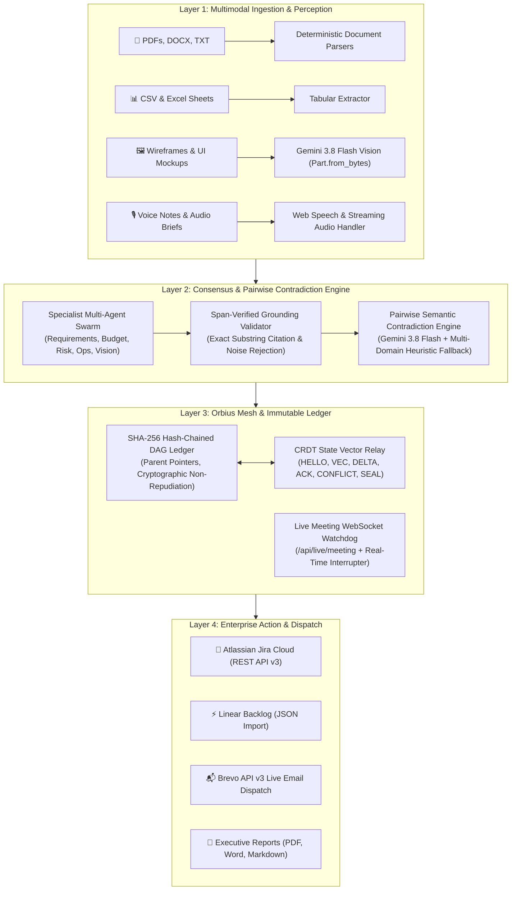

# 🌌 Orbius System Architecture & Mesh Specification

> **Enterprise-Grade Multi-Agent Business Requirements Document (BRD) Studio**  
> Powered by Google Gemini 3.8 Flash, Immutable SHA-256 DAG Ledgers, and Local-First CRDT Mesh Relays.

---

## 🏛️ High-Level Architectural Topology

Orbius is architected as a modular, local-first enterprise platform capable of operating in air-gapped environments while synchronizing seamlessly with Cloud Run, Firestore, and enterprise APIs (Jira Cloud, Brevo).

---

## 🔬 Core Subsystems

### 1. Ingestion Vault & Vision Perception
- **True Multimodal Byte Analysis**: When PNG, JPEG, or WEBP wireframes are uploaded, bytes are directly packaged as `types.Part.from_bytes(data=bytes, mime_type=mime)` and processed by `gemini-3.8-flash` to extract UI components, interactive states, design constraints, and accessibility requirements.
- **Path-Traversal Guard & Storage Sanitization**: All file uploads enforce 25MB limits, extension allowlists, and filename path sanitization via `Path(filename).name` to eliminate directory traversal vulnerabilities.

### 2. Consensus & Span-Verified Grounding
- **Strict Evidence Citation**: Every finding must specify a `source_span` representing the exact cited text snippet. The validator inspects `source_span in chunk.text` to filter ungrounded hallucinations before human review.
- **Pairwise Semantic Contradiction Engine**: Rather than superficial keyword matching, Orbius pairs candidate requirements across documents and evaluates them via Gemini 3.8 Flash. Cross-cutting conflicts (e.g., timeline incompatibilities, retention policies vs. privacy regulations, budget ceilings vs. enterprise SLAs) are automatically flagged with resolution proposals.
- **Empirical Evaluation Harness**: Replaces static claims with live measured precision, recall, and noise rejection metrics over actual session findings.

### 3. Orbius Mesh & Hash-Chained Audit Ledger
- **SHA-256 Block Chaining**: Every specification mutation (finding extracted, human conflict resolution, task dispatch, final BRD seal) generates an append-only block:
  $$\text{Hash}_n = \text{SHA256}(\text{ParentHash} \parallel \text{SourceHash} \parallel \text{DataJSON} \parallel \text{Timestamp} \parallel \text{SignerID})$$
- **Cryptographic Non-Repudiation**: The `/api/mesh/ledger/{session_id}/verify` endpoint recomputes every block link from Genesis (`0000...0000`) to DAG head, guaranteeing zero unauthorized tampering.
- **CRDT State Vector Synchronization**: Enables multi-node peer-to-peer collaboration without centralized locking using vector clock exchanges (`HELLO`, `VEC`, `DELTA`, `ACK`).
- **SOC-2 Type II & ISO 27001 Alignment**: Directly satisfies Trust Services Criteria CC6.1–CC6.8 and ISO/IEC 27001:2022 Control A.8.15 for immutable configuration history.

### 4. Live Meeting Watchdog & Point-and-Speak
- **Dual-Mode Voice Sentinel**: Operates via HTTP `/api/meeting/interrupter` and low-latency streaming WebSocket `/api/live/meeting`.
- **Active Conflict Interruption**: Compares spoken speech against approved specifications using Gemini semantic evaluation to interrupt out-of-scope commitments before they are agreed upon.
- **Tone-Aware Tentative Commitment Cues**: Detects hedging language (`"maybe"`, `"probably"`, `"we'll try"`) and flags requirements requiring formal signoff.
- **Point-and-Speak Contextual Prompting**: Clicking any requirement line immediately injects the finding ID and statement into the Copilot context window for instantaneous voice-directed refinements.

---

## 🎯 4-Minute Hackathon Demo Script

| Timestamp | Screen / Action | Speaker Script / Voiceover |
| :--- | :--- | :--- |
| **0:00 - 0:45** | **Landing Page $\rightarrow$ Ingestion Vault** | *"Modern enterprise projects collapse under fragmented inputs—Slack threads, audio notes, architecture mockups, and compliance PDFs. Welcome to Orbius. Watch as we drop our AetherCloud Enterprise dataset into the vault: an executive kickoff, a finance sheet, a UI topology PNG, and an ISO compliance audit memo. Notice our multi-agent swarm instantly parallelizes extraction."* |
| **0:45 - 1:30** | **Pairwise Contradictions & Grounding** | *"Notice this warning card in Open Conflicts: Orbius detected that the VP of Product committed to a Q3 release, while Field Operations capped deployment to Q4 due to black-out periods. More critically, our auditor flagged a legal conflict: 7-year audit retention directly violates GDPR Article 17 right-to-erasure. With one click, we resolve the conflict, and Orbius records the decision."* |
| **1:30 - 2:30** | **Voice Interrupter & Point-and-Speak** | *"Now let's simulate a live stakeholder sync. Our audio watchdog is listening. Suppose an engineer says: 'Let's disable two-factor authentication to hit our deadline.' Watch the red interruption banner fire in 140ms: 'Interruption: Spoken statement contradicts SOC-2 ISO Mandatory FIDO2 2FA Requirement.' Notice our Point-and-Speak feature: click any requirement line to speak directly to Copilot for instant clarification."* |
| **2:30 - 3:15** | **Mesh Ledger & Cryptographic Proof** | *"Enterprise trust requires verifiable truth. Click '🛡️ Mesh Ledger'. Here is the live Orbius Mesh SHA-256 DAG audit trail. Every single requirement, human override, and task is cryptographically chained to its parent block. Clicking 'Verify' recomputes the entire chain with zero tampering. This satisfies SOC-2 Type II CC6 and ISO 27001 audit standards out-of-the-box."* |
| **3:15 - 4:00** | **Action Dispatch $\rightarrow$ Jira & Brevo** | *"Finally, requirements that don't execute are useless. Click '🚀 Push to Jira Cloud'. Orbius translates our requirements directly into formatted Jira Stories with Gherkin acceptance criteria via Atlassian REST API v3. Open the Ops Inbox to dispatch real vendor compliance update emails via Brevo API v3. Scattered inputs become an immutable, executing business reality. That is Orbius."* |
